<p align="center">
  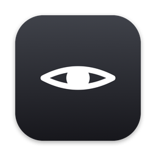
</p>

<h1 align="center">Squint</h1>

<p align="center">
  <b>Screenshots, minus the secrets.</b><br>
  A macOS menu bar app that hides passwords, API keys and personal details in every screenshot,<br>
  before you paste it anywhere. Gemma 3 runs on your Mac, and nothing leaves it.
</p>

<p align="center">
  <a href="https://github.com/Marky2813/squint/releases/latest/download/Squint.dmg"><b>Download for macOS</b></a>
  &nbsp;·&nbsp;
  <a href="https://mysquint.tech">mysquint.tech</a>
  &nbsp;·&nbsp;
  <a href="https://youtu.be/PY82pvmH1iQ">Watch the demo</a>
</p>

<p align="center">
  <sub>macOS 14+ · Apple Silicon and Intel · signed and notarized · MIT</sub>
</p>

<p align="center">
  <a href="https://youtu.be/PY82pvmH1iQ">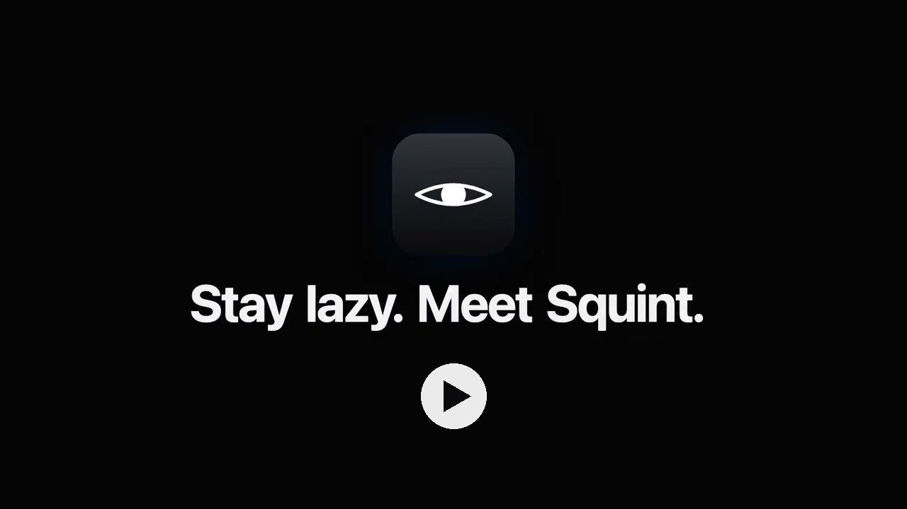</a>
</p>

---

## Why

You paste screenshots into AI all day: a bug, an error, a form. Each one can carry
something you didn't mean to share, like an API key in a terminal, a phone number in a
notification or an email in the corner of a dashboard. You checked the bug. Did you check
the corners?

Squint checks them for you. Take a screenshot the way you always do, and the clipboard
already holds a safe copy by the time you press ⌘V.

A real screenshot from my desk, before and after:

<table>
  <tr>
    <th width="50%">Before</th>
    <th width="50%">After</th>
  </tr>
  <tr>
    <td>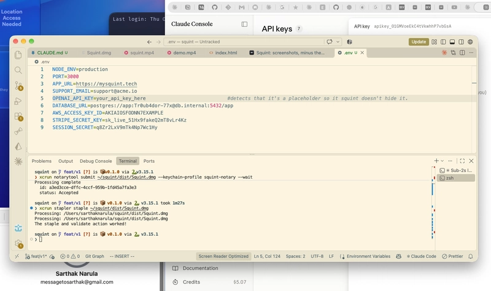</td>
    <td>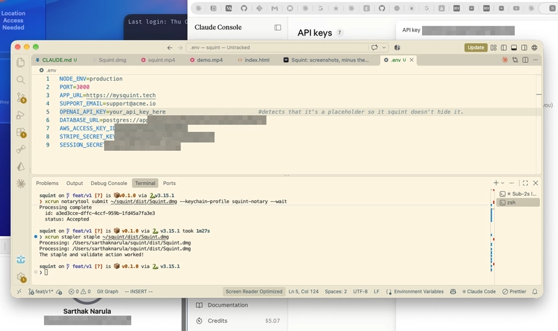</td>
  </tr>
</table>

<p align="center"><sub>After: the keys, the database password and my email are gone. The settings, the placeholder key and the terminal log are still there for the AI to read.</sub></p>

## How it feels

<p align="center">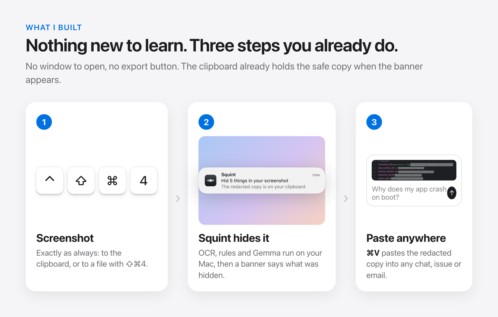</p>

No window to open and no export button. A banner tells you what was hidden. If you want
to check, click it and you'll see the screenshot exactly as it will be pasted:

- **Click** a hidden item to show it again, and click again to hide it.
- **Drag** across anything Squint missed to cover it with an opaque box. Click the box to remove it.
- **Right-click** to switch between pixelate, blur and solid.
- **Esc** or **Space** closes the window.

Every change updates the clipboard immediately. The original file is never modified; the
redacted copy is saved next to it as `<name>.redacted.png`.

<p align="center">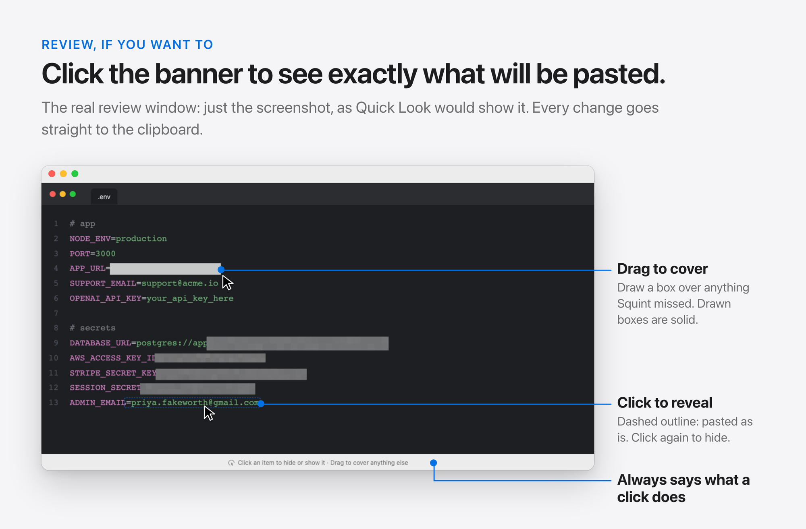</p>

## Install

1. [Download **Squint.dmg**](https://github.com/Marky2813/squint/releases/latest/download/Squint.dmg) and drag Squint into Applications.
2. Open Squint. The welcome window sets up what it needs:
   - **Ollama**, which runs AI models locally (click Download if you don't have it), and
   - **Gemma 3 4B** (3.3 GB, downloaded once, with a progress bar).
3. Click **Start Squint** and look for the narrowed eye in the menu bar.

When macOS asks whether Squint may access your Desktop, allow it: that's where screenshots
are saved. While Squint runs, macOS's floating screenshot thumbnail is turned off so files
are saved straight away. Your setting comes back when you quit.

<p align="center">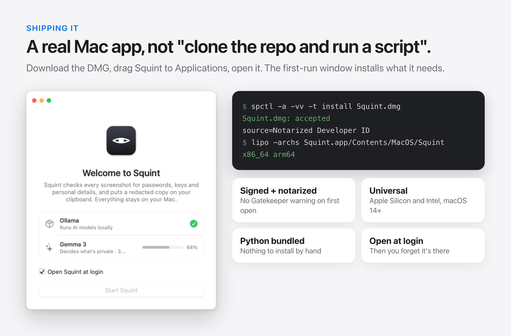</p>

## How it works

<p align="center">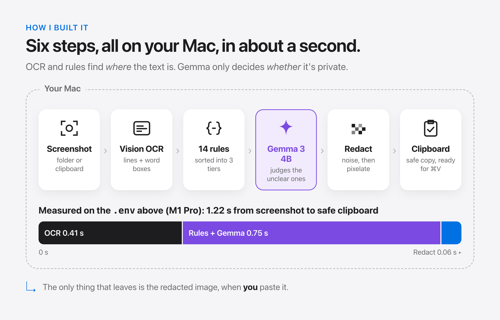</p>

1. **Catch:** Squint watches the screenshot folder (⇧⌘4) and the clipboard (⌃⇧⌘4).
2. **Read:** Apple's Vision framework reads every line, with a box for every word, on device.
3. **Find:** 14 regex rules sort each match into a tier. Obvious secrets (AWS, Stripe,
   GitHub, Slack and Google keys, JWTs, private keys, URL passwords, Luhn-valid cards) are
   hidden at once. Placeholders, UUIDs, commit hashes and `noreply@` addresses are dropped.
4. **Judge:** Gemma 3 4B decides the ambiguous ones, like emails, phone numbers,
   `password = …` and random-looking strings.
5. **Redact:** each region is replaced with noise and then pixelated, so it can't be undone.
6. **Copy:** the safe image goes to the clipboard.

<details>
<summary><b>Regex decides where, Gemma decides whether</b></summary>
<br>

Gemma never sees the image and never draws a box. It gets the matched text and about a
line of context, and answers through a JSON schema that allows exactly one boolean. If
it's slow, offline or confused, the item is hidden. The worst case is over-redaction,
never a leak.

<p align="center">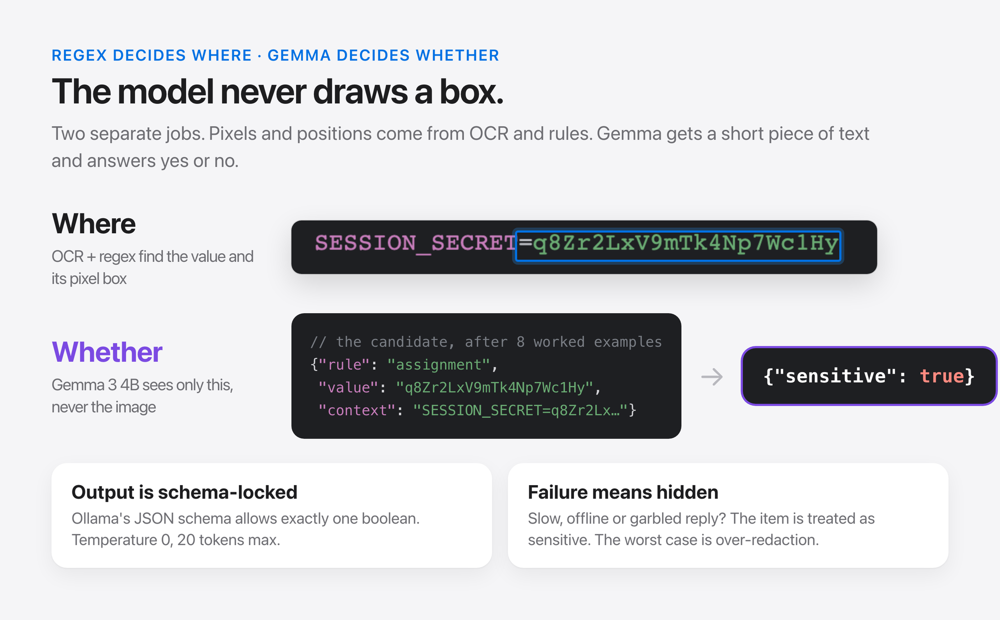</p>
<p align="center">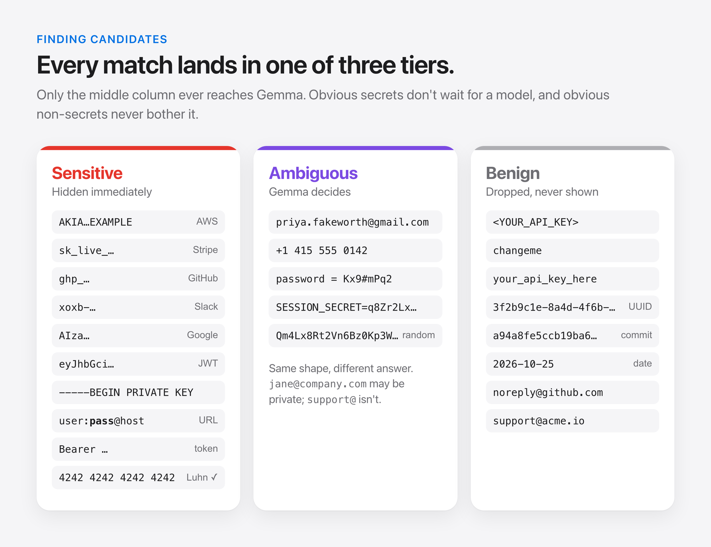</p>
</details>

<details>
<summary><b>Making a 4B model answer in a third of a second</b></summary>
<br>

One call per candidate, four running in parallel. The instructions and eight worked
examples are a shared prefix, kept in Ollama's prompt cache from startup through `raw`
mode and Gemma's chat template written by hand, so only the candidate is new work. That
comes to about 0.36 s per candidate.

<p align="center">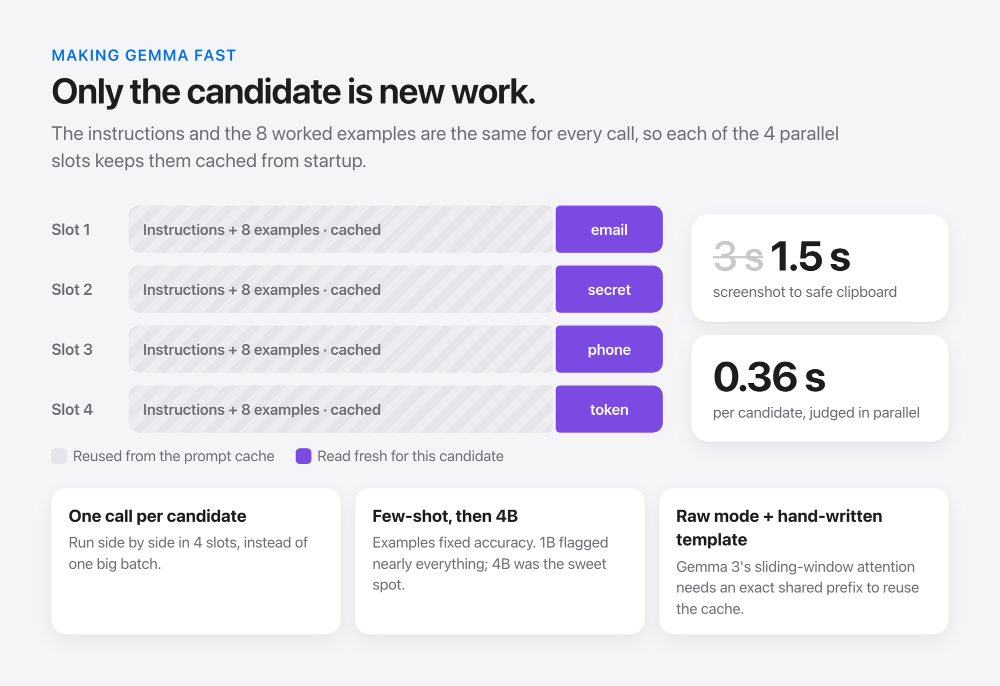</p>
</details>

<details>
<summary><b>Hiding only the value, irreversibly</b></summary>
<br>

OCR returns `STRIPE_SECRET_KEY=sk_live_…` as one word. Squint finds the value inside it
from character positions, so the name stays readable. The pixels are destroyed before
they're pixelated: two different keys produce identical redacted images.

<p align="center">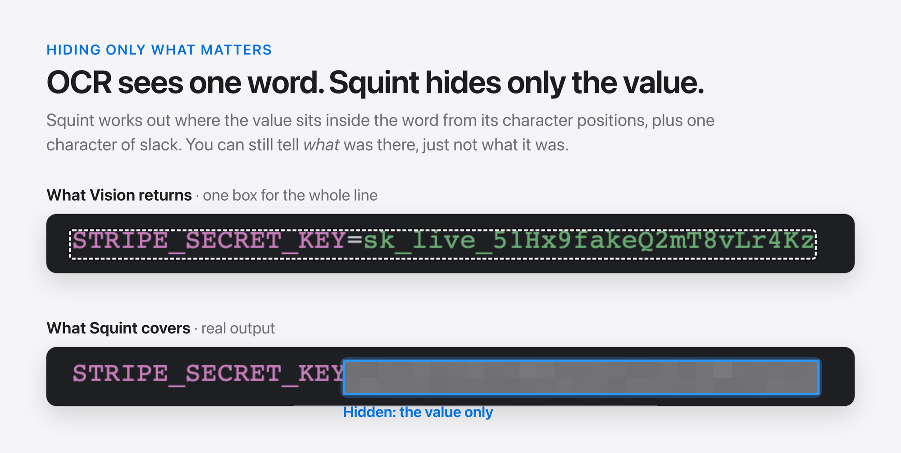</p>
<p align="center">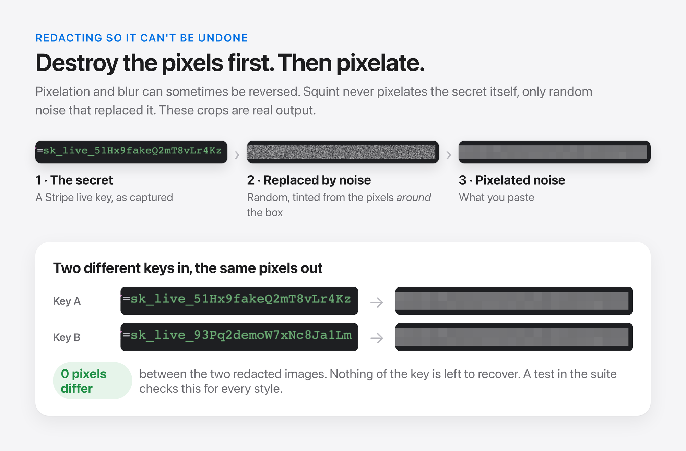</p>
</details>

## Private by design

<p align="center">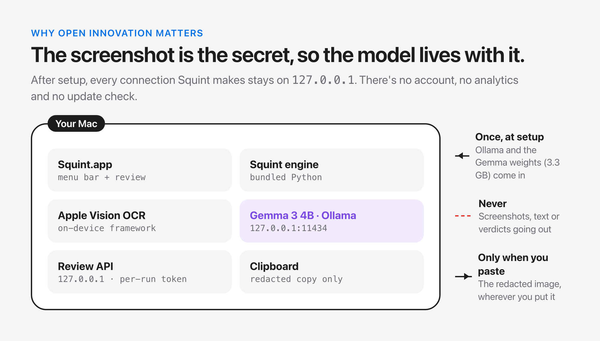</p>

After setup, every connection Squint makes stays on `127.0.0.1`: Ollama, and a review API
that needs a per-run token. There are no accounts, analytics or update checks. A cloud
model couldn't do this job, because the screenshot is the secret.

## Accuracy

Measured on 24 generated screenshots in three fonts, light and dark, all with fake keys.
Because the screenshots are rendered by the eval script, it knows every secret's exact
pixels and checks that each one is **fully covered**, not just detected. Five are held out
and never tuned against.

<p align="center">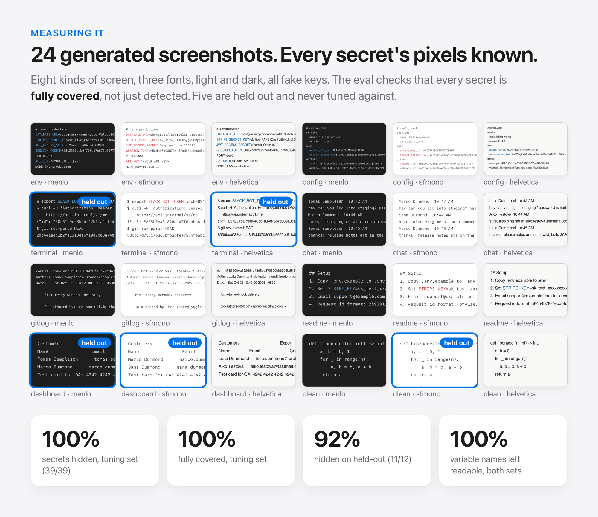</p>

| | Tuning set (19) | Held-out (5) |
|---|---|---|
| Secrets hidden | **100%** (39/39) | 92% (11/12) |
| Fully covered, no visible edges | **100%** | 92% |
| Variable names left readable | 100% | 100% |
| Hidden items that were really secrets | 98% | 79% |

With Gemma switched off, false alarms go from **4 to 10** across all 24 screenshots, at
the same recall.

## Limitations

- **macOS only.** The core is platform-independent; only OCR and clipboard access are Mac-specific.
- **Text only.** Faces, photos of documents and anything OCR can't read go straight through.
- **Synthetic eval.** Real screenshots are messier than the ones I generated.
- **First-run size.** Needs Ollama and a roughly 3 GB model download.
- **Known miss:** a long token in a proportional font can leave its first character visible.

## Build from source

Requires macOS 14+, Xcode command line tools and [uv](https://docs.astral.sh/uv/).

```sh
uv sync
uv run pytest                        # 199 tests
uv run python scripts/build_app.py   # → dist/Squint.app and dist/Squint.dmg (universal)
uv run python eval/run_eval.py       # accuracy on the eval set (--held-out for the 5)
```

A release build needs a Developer ID Application certificate and a notarytool profile
(see the top of `scripts/build_app.py`):

```sh
uv run python scripts/build_app.py --sign "Developer ID Application: …" --notarize squint-notary
```

To run the engine from a terminal instead of the app:

```sh
uv run squint watch                          # needs `ollama serve` with gemma3:4b pulled
uv run squint check path/to/screenshot.png   # one file: findings, timing, redacted copy
```

Logs are in `~/Library/Logs/Squint/squint.log` (menu bar → Show Log).

<details>
<summary><b>Project layout</b></summary>
<br>

```
src/squint/core/            OCR-agnostic pipeline: candidates, Gemma client, geometry, redaction, review
src/squint/platforms/macos/ Vision OCR, clipboard, desktop settings, and the SwiftUI app
src/squint/server.py        localhost review API used by the app
eval/                       fixture generator, labels and the coverage-scoring eval
scripts/build_app.py        universal, signed and notarized .app and .dmg
site/                       mysquint.tech
video/                      the demo film, made with Remotion
```

`core/` never imports from `platforms/`, so a Windows or Linux port only needs a new platform layer.
</details>

## Built with

[Gemma 3](https://ai.google.dev/gemma) via [Ollama](https://ollama.com) · Apple Vision ·
SwiftUI · Python · [Claude Code](https://claude.com/claude-code). Made for the
Hacktoberfest 2026 Open-Source AI Challenge.

## License

[MIT](LICENSE)
